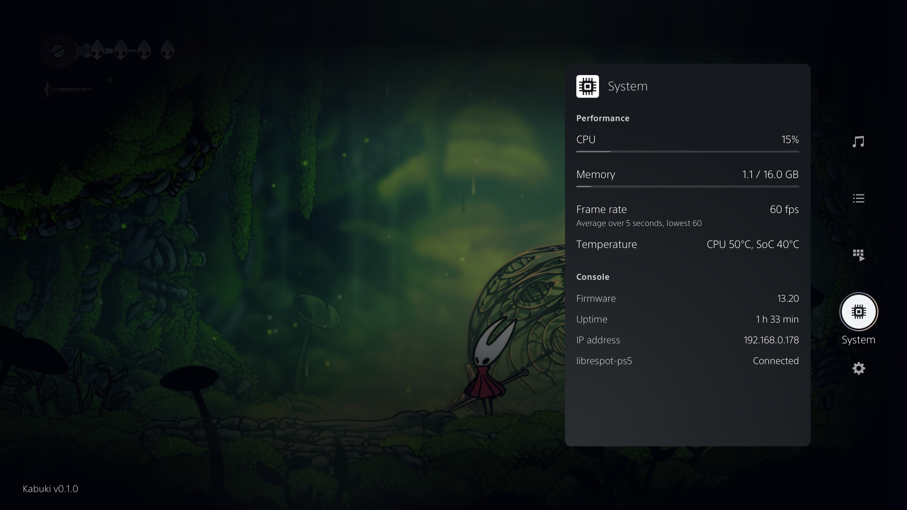

<p align="center">
  <picture>
    <source media="(prefers-color-scheme: dark)" srcset="docs/images/kabuki-dark.png">
    
  </picture>
</p>

<p align="center">
  &nbsp;
  &nbsp;
  <a href="LICENSE"></a>&nbsp;
  
</p>

<p align="center">
  
</p>

<p align="center"><em>Kabuki running on PS5, shown over a game.</em></p>

<hr>

<h3 align="center">Kabuki for PS5 13.60: native ShellUI homebrew overlay</h3>

<hr>

## Contents

[Firmware and upstream](#firmware-and-upstream) · [Features](#what-it-does) · [Librespot](#with-librespot-ps5) · [Get started](#get-started) · [Controls](#using-it) · [Add tiles](#adding-your-own-tiles) · [Build](#building) · [PC preview](#pc-preview) · [Credits](#credits)

Kabuki is a native control panel for homebrew that runs ShellUI code.

Hold your configured shortcut (default: **L3 + R3**) and Kabuki pops in from the right, over the home screen or your game, using the console's own interface toolkit, fonts, icons, focus effects and sounds.

Payloads can add their own tiles, display information and receive controller input through Kabuki. System readings and settings are built in; [librespot-ps5](https://github.com/stupiditytries/librespot-ps5) adds music controls, a queue and a library browser.

## Firmware and upstream

This repo builds on the original [Kabuki PS5 project](https://github.com/stupiditytries/kabuki-ps5), including its native ShellUI overlay, configurable shortcut, provider tiles, controller navigation and PC preview. This 13.60-focused version adds settings for the shortcut and tile layout, plus Librespot status, tile visibility and graceful-stop controls.

The original Kabuki project reports testing on firmware **13.20**. The changes in this repo target **13.60**, but have not yet been confirmed on-console; treat that firmware as experimental. Kabuki checks runtime methods and hook instructions rather than relying on a firmware allowlist, but those checks cannot guarantee compatibility when ShellUI differs. Please include your firmware version and relevant logs when reporting results.

## Get started

Check [Releases](https://github.com/kalkleven/kabuki-ps5-13.60/releases) for available builds. Any build targeting firmware 13.60 is experimental and has not been confirmed on-console; review its release notes and checksum before loading it. To compile the source yourself, follow [Building](#building). For loading a built ELF, follow [Using it](#using-it).

## What it does

- *Opens over the home screen or a game.* Hold a configurable button shortcut to bring up the panel.
- *Uses the console's native UI.* PUI widgets, SST fonts, system icons, UI3 glass focus and interface sounds.
- *Keeps your controls together.* Choose and arrange up to seven visible tiles; the first tile opens with the panel.
- *Shows system readings.* CPU load, memory, temperatures and frame rate where the console exposes it.
- *Lets you make it yours.* Change the shortcut, its hold time, interface sounds and tile order from Kabuki Settings. The Librespot page shows receiver status, lets you hide or show its music tiles, and can request a graceful stop of `librespot-ps5.elf`.
- *Hosts homebrew tiles.* Providers can use ready-made media and list cards, or supply a native plugin for a custom card.

### With librespot-ps5

librespot-ps5 adds three tiles:

- **Now Playing:** cover art, track information, play/pause, previous/next, seeking, volume, shuffle and repeat.
- **Queue:** browse upcoming songs and choose what plays next.
- **Library:** browse albums and playlists together in last-played order, then open their tracks.

librespot-ps5 handles Spotify pairing, playback and artwork caching. Kabuki displays its cards and sends your commands back to the receiver.

The modular receiver also includes a full-screen Music Player app. Use its own instructions for installation and features.

## What you need

- A modified PS5 that can load ELF payloads.
- A USB drive for the payload.
- A compatible provider if you want additional tiles, such as librespot-ps5.

Kabuki's System and Settings tiles work independently of a music receiver.

## Using it

1. Put `kabuki-ps5.elf` on a USB drive. If you use librespot-ps5, put it beside `librespot-ps5.elf`.
2. Load Kabuki manually with your payload loader.
3. Load any compatible providers you want to use.
4. Hold **L3 + R3 for half a second** to open the panel.

| Control | Action |
|---|---|
| L3 + R3, held | Open or close Kabuki with the default shortcut |
| D-pad | Move through the sidebar and the selected card |
| Cross | Open a tile, select an item or use a control |
| Circle | Go back within a card, return to the sidebar or close the panel |

Opening the console's own control centre closes Kabuki's panel.

Your shortcut, hold time, sounds and tile arrangement are saved in `/data/custom-overlays`. Kabuki does not add itself to autoload. The same folder holds its logs and runtime records.

## Adding your own tiles

A provider connects to Kabuki's local broker and registers the tiles it owns. Kabuki handles navigation, layout and controller focus for the built-in card templates:

- **Media cards** for playback information and controls.
- **List cards** for menus, libraries and nested lists.

The protocol is versioned, and a C SDK and example providers are included. Start with the [provider protocol](protocol/PROTOCOL.md), [C SDK](sdk/c/kabuki.h) and [hello-tile example](examples/hello-tile/).

For cards the templates cannot express, the [native plugin API](sdk/plugin/kabuki_plugin.h) exposes widget creation, animation, data and actions. See [Writing a plugin](docs/WRITING-A-PLUGIN.md) and the [custom-card example](examples/custom-card/).

**Native plugins are not sandboxed.** They run inside SceShellUI and can crash the home screen. Kabuki handles callback errors and repeated slow frames, but it cannot protect against arbitrary native memory faults. Use the template cards when they fit.

## Building

Build on Linux or WSL with the [PS5 Payload SDK](https://github.com/ps5-payload-dev/sdk), Python 3 and a C++20 host compiler for the tests.

Set `PS5_PAYLOAD_SDK` to your SDK directory, then run:

```bash
python3 tools/fetch-deps.py
bash tests/run.sh
bash build.sh
```

The payload is written to `build/kabuki-ps5.elf`. The build checks that it stays under the 2 MiB payload limit.

GitHub Actions also builds and tests each push or pull request. Version tags create a draft release with the payload and checksums; see [Releasing](docs/RELEASING.md).

See [Developing Kabuki](docs/DEVELOPING.md) for the development loop, logs and development builds, and [Architecture](docs/ARCHITECTURE.md) for how the daemon and ShellUI worker fit together.

## PC preview

The console layout also runs on a PC, with keyboard and controller input. It uses the same layout and navigation code, so you can develop cards and check transitions before building a console payload.

```bash
python3 tools/fetch_console_assets.py <console-ip>
python3 preview/native_preview.py
```

Open `http://127.0.0.1:8765`. Space opens the panel, the arrow keys move, Enter is Cross and Esc is Circle.

The preview uses fonts and UI resources copied from your own console. Those files stay local and are excluded from the repository. Native plugins can also be built for the host preview.

## Credits

- The [PS5 Payload SDK](https://github.com/ps5-payload-dev/sdk) and John Tornblom's [shsrv](https://github.com/ps5-payload-dev/shsrv).
- [ps5-dualsense-overlay](https://github.com/erickdavestech/ps5-dualsense-overlay), whose loader work Kabuki's ShellUI loader is adapted from. Upstream sources and pinned revisions are listed in [src/loader/SOURCES.md](src/loader/SOURCES.md).
- [JSON for Modern C++](https://github.com/nlohmann/json), used by the provider broker and settings.
- [stb](https://github.com/nothings/stb), used by the PC preview.
- [Plus Jakarta Sans](https://github.com/tokotype/PlusJakartaSans), used in the Kabuki wordmark, under the SIL Open Font License.

## License and disclaimer

Kabuki is free software under the **GNU General Public License, version 3 or later**. See [LICENSE](LICENSE). Third-party components retain their own licenses.

Kabuki is an unofficial homebrew project. It is not affiliated with, endorsed by or supported by Sony Interactive Entertainment. PlayStation and PS5 are trademarks of their respective owners. Kabuki comes with no warranty, as set out in the license.
